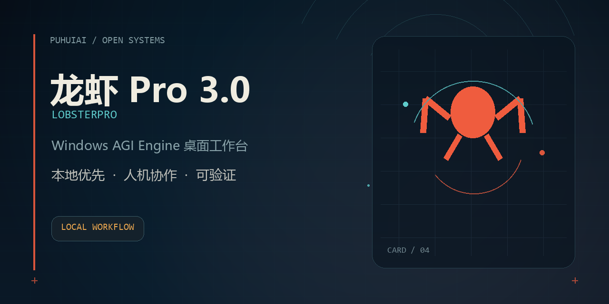

# 龙虾 Pro 3.0 LobsterPro：Windows AI Agent 桌面工作台

龙虾 Pro 3.0 是一款面向 Windows 的 AI Agent 桌面工作台。它连接大模型、任务流程和本地工具，支持 OpenAI 兼容接口、DeepSeek 与 Ollama。软件免费使用，闭源发布。

## 下载

- [下载龙虾 Pro 3.0](https://github.com/puhuiai/lobsterpro3/releases/download/v3.0.0/LobsterPro3.0_Setup.exe)
- [查看全部 Releases](https://github.com/puhuiai/lobsterpro3/releases)
- [产品中心](https://puhuiai.github.io/website/#lobsterpro)

## 核心能力

- 统一管理模型、任务流程与本地工具
- 支持 OpenAI 兼容接口
- 支持 DeepSeek API
- 支持本地 Ollama 模型
- 用自然语言组织和执行复杂任务
- 桌面端工作台，无需浏览器切换

## 安装

1. 下载 `LobsterPro3.0_Setup.exe`
2. 运行安装程序并按提示完成安装
3. 首次启动时配置模型服务与密钥

## 系统要求

- Windows 10 / 11 64 位
- 8GB 内存起，推荐 16GB
- 可访问所选大模型服务，或在本机运行 Ollama

## 文档

- [使用说明书](docs/使用说明书.md)
- [安装说明书](docs/安装说明书.md)

## 反馈

问题与建议请提交 [Issues](https://github.com/puhuiai/lobsterpro3/issues/new/choose)，并附 Windows 版本、报错截图与复现步骤。

## 授权

龙虾 Pro 免费使用，闭源发布。禁止反编译、二次打包和商业转售。模型 API 费用由用户自己的服务账号承担。

Built by 汪君 · 普惠AI
